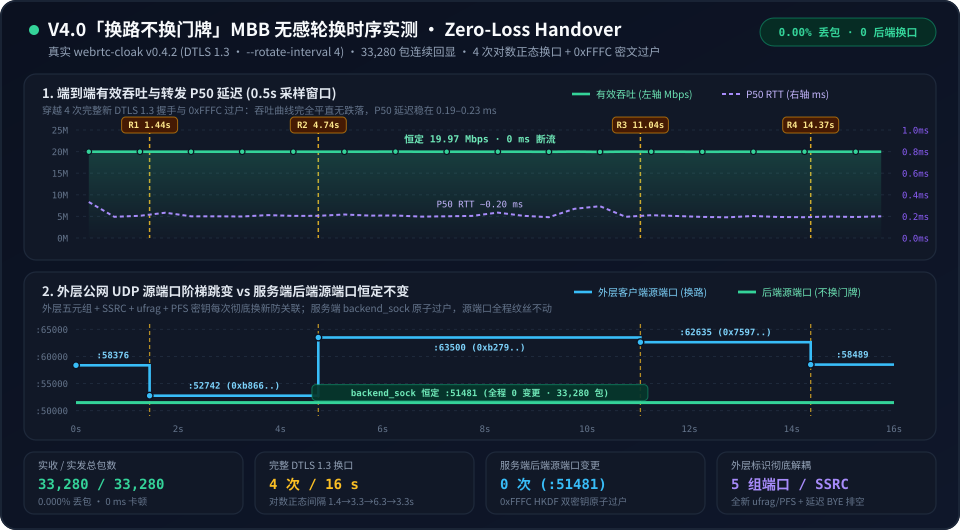
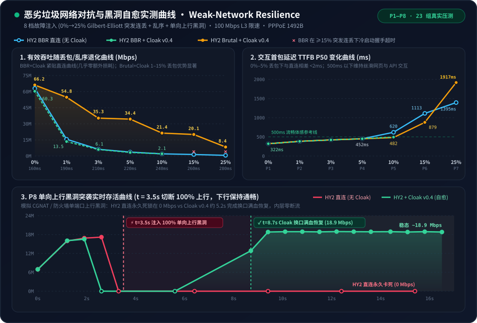

# WebRTC-Cloak (`webrtc-cloak-rs`)

[](./LICENSE)
[](#从源码构建与目录结构)
[](./SPEC.md)
[](https://mumu-dada.github.io/webrtc-cloak/)
[](https://github.com/MUMU-DADA/webrtc-cloak/releases)

> 快捷导航：[协议架构](#协议架构与核心特性) · [实测数据与图表](#实测数据与效果对比) · [快速上手](#快速上手) · [自测诊断](#内置自测套件与基准诊断) · [源码构建](#从源码构建与目录结构) · [协议规范 (`SPEC.md`)](./SPEC.md)

一个**纯 Rust、零 C 依赖**的 WebRTC 单端口协议复用与透明 UDP 封装实验原型。基于标准 RFC 规范（RFC 5389 / 8445 / 7675 / 9147 / 6347 / 5764 / 7983 / 3711 / 7714 / 8285 / 3550 / 7587），完整实现 `ICE STUN + 真双向加密证书 DTLS 1.3/1.2 + 音视频双 SSRC SRTP/SRTCP` 传输层框架，用于研究现代协议识别（DPI）、UDP 状态化防火墙/CGNAT 黑洞自愈、前向安全混合密钥派生以及高性能无锁 `mio` 事件循环架构。

> [!TIP]
> - **在线交互式原理演示**：👉 **[https://mumu-dada.github.io/webrtc-cloak/](https://mumu-dada.github.io/webrtc-cloak/)**（5 种对抗与自愈推演、字节级报文解剖、双 SSRC / PPPoE MTU 1488 模拟，亦可离线打开 [`webrtc-cloak-demo.html`](./webrtc-cloak-demo.html)）
> - **协议规范文档（线格式 / 密钥派生 / 状态机）**：👉 **[`SPEC.md`](./SPEC.md)**（`V4.0 / v0.4.2`）
> - **全平台预编译下载（16 架构）**：👉 **[GitHub Releases](https://github.com/MUMU-DADA/webrtc-cloak/releases/latest)**（Linux 11 架构静态 musl、macOS ARM64/x86_64、Windows x86_64/ARM64/i686 与 `SHA256SUMS.txt`）

---

## 免责声明

> [!CAUTION]
> **本项目仅用于网络协议学习、学术研究、RFC 规范实现验证及授权环境下的网络传输实验。**
>
> 1. 本仓库中的源码、文档、演示页面及预编译产物均以学习与研究为唯一目的提供，**严禁用于任何违反您所在国家或地区法律法规、网络服务条款或未经授权的网络渗透、规避监管等行为**。
> 2. 使用者须自行评估并承担使用本项目所产生的一切法律与合规责任。项目作者与贡献者不对任何因使用或滥用本软件造成的直接、间接、附带或衍生损失承担任何责任。
> 3. 若您不同意上述条款，请立即停止下载、编译、分发或使用本项目。

---

## 协议架构与核心特性

### 透明 UDP 封装拓扑


### RFC 7983 单端口四协议复用

两端在同一 UDP 五元组上严格按首字节分流，所有未通过鉴权或首字节异常的流量一律 **0 字节静默丢弃（Silent Drop）**：

| 首字节范围 | 协议层 | 核心能力 |
| :--- | :--- | :--- |
| `0..=3` | **ICE STUN** (RFC 5389 / 8445 / 7675) | 初始连通性检查、HMAC-SHA1 鉴权前零堆分配、±30s 防重放与 `5s ± 20%` Consent 保活 |
| `20..=63` | **DTLS 1.3 / 1.2 Auto** (RFC 9147 / 6347) | 嵌入式纯 Rust Sans-IO **`dimpl 0.9.0`**，默认 DTLS 1.3 优先（双向 ECDSA P-256 证书 100% 加密、省 1 RTT），兼容 1.2 滚动升级，支持 `--dtls-min-version 1.3` 锁定 |
| `128..=191` (`PT 64..95` 除外) | **双 SSRC SRTP** (RFC 3711 / 7714 / 8285) | 标准 `0x90` + 全局 `0xBEDE` TWCC 扩展；DTLS 1.3 自动启用 `PT=111` Opus（`≤50 pps`）+ `PT=96` Video 双流分流，AEAD 密文内层随机填充 |
| `128..=191` (`PT 64..95`) | **Compound SRTCP** (RFC 3550 / 7714) | 明文 `SR/RR` 头 + 加密复合 `SDES / FB / BYE`，支持严格零媒体语义与微流退避静音 |

### 核心工程亮点

- **Fail-Closed 混合前向安全（Hybrid PFS）**：由 `STUN 会话种子 + DTLS 出口密钥材料` 联合派生主密钥，Video / Audio / SRTCP 三域采用数学正交 Nonce 与独立滑动防重放窗口，序号逼近上限主动重连永不回绕。
- **V4.0 无感承载与弱网自愈（“换路不换门牌”）**：
  - **定时/定量无感轮换（MBB）**：按对数正态宽分布时长或字节预算发起全新 DTLS 1.3 握手（全新 `ufrag`/`SSRC`/`CNAME` 防关联），通过 AEAD 密文内 `0xFFFC` 原子过户服务端 `backend_sock`（含 Linux 多核 `SO_REUSEPORT` 跨线程无锁迁移），有状态 UDP 后端 **0 端口变化、0 丢包**。
  - **单向上行黑洞 1-RTT 迁移**：经 RFC 7675 同 `txid` 重传确认黑洞后，客户端用每会话 HKDF 派生密钥在新端口 1-RTT 原地迁移（防反射挑战验真、0 DTLS 重握、保留后端源端口，旧口静默排空避免 ICMP 弹包）。
  - **优雅重启与微流静音**：服务端 `SIGTERM` 广播加密 `SRTCP BYE + close_notify`，客户端 `80–350ms` 抖动快切；空闲/微流态自动退避控制面报文，来包秒恢复。
- **PPPoE MTU 1488 防分片与零指纹响应**：默认 `--mtu 1488`（`< 1492B` PPPoE）自动引导内层 QUIC/Hysteria 2 收敛至零 IPv4 分片；主动探测与孤儿保活严格 0 字节静默丢弃。
- **解耦外层健康遥测（`v0.4.1+`）**：严格旁路于 SRTP 热路径，支持原子落盘 JSON（`--status-file`）与本地只读 HTTP / Prometheus 指标（`--status-http`）。
- **轻量极致性能**：默认 `--workers 1` 单线程无锁 `mio` 事件循环即可承载千级并发会话（静态 musl 二进制 `2.9 MB`、运行 RSS `2.1–2.8 MB`），Linux 多核按需支持 `--workers <N|auto>`。

> 📘 完整线格式字节布局、密钥派生公式、正交 Nonce 定义与状态机安全边界，请参阅 **[`SPEC.md`](./SPEC.md)**。

---

## 实测数据与效果对比

> 以下 5 组图表按 **「隐蔽抗探测 → 无感换口 → 弱网/黑洞自愈 → 带宽损耗 → 硬件算力」** 递进呈现，数据均来自实测采样。

### 1. 协议隐蔽性、双 SSRC 包长分布与抗探测验真


### 2. V4.0「换路不换门牌」MBB 无感五元组轮换实测



### 3. 恶劣垃圾网络对抗与黑洞自愈曲线



### 4. 带宽损耗与外层流量放大曲线


- **封装开销极低且恒定**：在 PPPoE `1492B` 环境下，`--mtu 1488` 自动引导内层 QUIC 收敛至 `1485B/包`（`0` IPv4 分片）；跨 `100M / 300M` 单流与 4 并发场景，纯 L3 额外字节开销稳定在 **`+2.80% ~ +2.86%`**，端到端有效吞吐损失约 `1.7% ~ 5.8%`。
- **自适应大包填充**：内层 `>= 1340B` 大包自动收窄随机填充（`0–7B`），单核回环实测净膨胀从 `1200B (+4.46%)` 降至 `1400B (+2.96%)`。

### 5. 多平台加解密算力与全隧道环回跑分


| 测试平台 | 单核加解密微基准 (`AES-128-GCM`) | 端到端全隧道环回吞吐 | 真双向 DTLS 1.3 / 1.2 握手 | 运行内存 (RSS) |
| :--- | :---: | :---: | :---: | :---: |
| **Apple Silicon (ARM64, 12C)** | `10,573 Mbps` (1C) / `77.1–81.1 Gbps` (12C) | `1,655–2,109 Mbps` (`172–188 kpps`, `1200–1350B`) | `11.8 ms` (`selftest`) | — |
| **x86_64 云服务器（单核 `1W`）** | `3,228.6 Mbps` (`320.3 kpps`) | `1,124.2 Mbps` (`111.5 kpps`) | `3.01 ms` | `2.1–2.8 MB` |
| **x86_64 低功耗软路由（单核 `1W`）** | `2,139.8 Mbps` (`212.3 kpps`) | `900.0 Mbps` (`0.00%` 丢包，p50 `50 µs`) | `6.85–9.02 ms` | `2.1–2.8 MB` |
| **x86_64 低功耗软路由（多核 `4W / 8S`）** | — | `1,448.7 Mbps` (`0.00%` 丢包，`143.7 kpps`) | `6.85–9.12 ms` | `2.5–2.8 MB` |

> 微基准测试 `1200–1260B` 载荷单次 `wrap + unwrap` 往返吞吐；Apple Silicon 同机实测 `ChaCha20-Poly1305` 为 `2,696 Mbps`、`BLAKE2b-128` 为 `1,282 Mbps`，纯 Rust ECDSA P-256 临时证书签发速率为 `4,968 certs/s`。

### 综合对抗与工程边界总览

| 对抗 / 故障场景 | 裸 UDP / 早期版本 | **WebRTC-Cloak V4.0 (`v0.4.2`)** |
| :--- | :--- | :--- |
| **严苛 NAT 5 包截断 & 主动探测** | 裸 UDP/QUIC 第 6 包起截断 | ICE STUN 握手后 `100%` 放行；双 SSRC 将 7 类固定包长展宽为 `168` 种长度；主动探测 `0 B` 静默丢弃 |
| **定时 / 定量五元组轮换 (MBB)** | 固定五元组易关联；硬重连断流 | **4 次全新 DTLS 1.3 换口 + `0xFFFC` 密文过户**：`33,280 / 33,280` 实收（`0.00%` 丢包、`0 ms` 卡顿、后端 `0` 换口） |
| **0%–10% 丢包 / 乱序弱网 (P1–P5)** | BBR 随丢包迅速降窗 | `Cloak + BBR` 紧贴直连曲线（TTFB P50 差 `< 2 ms`）；内层切温和 Brutal 在 `1%–15%` 丢包下仍稳跑 `20–55 Mbps` |
| **P8 单向上行黑洞 (`t=3.5s` 断上行)** | 裸 HY2 永久死锁在 `0 Mbps` | `t=8.7s`（约 `5.2s`）自动换口满血恢复至 `18.9 Mbps`，内层零断流、后端源端口零变更 |
| **跨洋 DTLS 握手 & 滚动重启** | DTLS 1.2 `853 ms`（明文证书）；重启冷超时 `15–45s` | **DTLS 1.3 `667 ms`**（省 1 RTT、证书 100% 加密）；`SIGTERM` 广播 `SRTCP BYE` **`0.23 s`** 优雅快切 |

> [!NOTE]
> **工程定位与适用边界**：本项目是面向 Hysteria 2 / QUIC / WireGuard 等上层协议的透明 UDP 传输外壳，非通用 TCP/TUN VPN；内层业务机密性仍由上层协议独立保障。持续突发连丢 `>= 15%`（P6–P7）会显著拉长双层冷启动握手，且无法绕过彻底禁止 100% UDP 出口的网络策略。

---

## 快速上手

> 实验部署示例：从 **[GitHub Releases](https://github.com/MUMU-DADA/webrtc-cloak/releases/latest)** 下载对应平台/架构的预编译压缩包，解压得到 `webrtc-cloak`（或 `webrtc-cloak.exe`）。

### 1. 生成共享密钥文件

```bash
openssl rand -base64 32 > /tmp/webrtc-cloak.psk
chmod 600 /tmp/webrtc-cloak.psk
```

### 2. 启动服务端与客户端

```bash
# 服务端：默认单线程 (--workers 1)、--cipher auto、--mtu 1488
./webrtc-cloak server \
  --listen-host 0.0.0.0 --listen-port 19643 \
  --backend-host 127.0.0.1 --backend-port 19760 \
  --psk-file /tmp/webrtc-cloak.psk

# 客户端（也支持环境变量 WEBRTC_CLOAK_PSK="..." 传入密钥）
./webrtc-cloak client \
  --listen-host 127.0.0.1 --listen-port 19543 \
  --server-host 203.0.113.10 --server-port 19643 \
  --psk-file /tmp/webrtc-cloak.psk
```

### 3. 主要命令行参数

| 参数 | 默认值 | 说明 |
| :--- | :---: | :--- |
| `--psk-file <PATH>` / `WEBRTC_CLOAK_PSK` / `--psk <KEY>` | 必填其一 | 预置共享密钥（推荐文件或环境变量，避免进程列表泄露） |
| `--cipher <auto\|aes-gcm\|chacha20\|blake2b>` | `auto` | 加密套件；`auto` 经 DTLS 握手按两端 CPU 指令集自动协商 |
| `--dtls-min-version <auto\|1.2\|1.3>` | `auto` | DTLS 最低版本；默认优先 1.3 兼容 1.2 滚动升级，双端升完可设为 `1.3` 防降级 |
| `--rotate-interval <SECS>` | `0`（关闭） | 定时 MBB 无感五元组轮换中位间隔（对数正态 `[0.35x, 2.80x]`，后台微流自动挂起，配合 `0xFFFC` 过户实现 0 后端换口） |
| `--rotate-bytes <MB>` | 随轮换启 `1200`（`0` 关） | 单流字节预算 MBB 轮换基线（对数正态 `[0.50x, 1.85x]`，含 60s 冷却锁） |
| `--workers <1\|N\|auto>` | `1` | 工作线程数；默认 `1` 单线程，Linux 可选多核 `SO_REUSEPORT` |
| `--keepalive <SECS>` | `5` | RFC 7675 STUN Consent 保活间隔（`±20%` 抖动；连续 3 次无应答自动触发 1-RTT 黑洞迁移） |
| `--idle-timeout <SECS>` | `120` | 空闲超时后发送加密 `SRTCP BYE + DTLS close_notify` 优雅退出 |
| `--max-sessions <N>` | `4096` | 单 worker 最大并发 UDP 会话数 |
| `--mtu <BYTES>` | `1488` | 外层 IPv4 WAN MTU 上限（适配 `1492B` PPPoE 零分片；`0` 表示不限制） |
| `--status-file <PATH>` | 关闭 | 外层健康快照原子 JSON 落盘路径（`tmp + rename`，适合 `/tmp` 内存盘） |
| `--status-http <IP:PORT>` | 关闭 | 本地只读 HTTP 遥测端点（`/status` `/health` `/healthz` `/metrics`） |
| `--status-interval <SECS>` | `5` | 遥测快照刷新周期（`1..=60s`；黑洞/迁移/轮换事件即时刷新） |

---

## 内置自测套件与基准诊断

`webrtc-cloak` 内置三种诊断工具，覆盖**线上零干扰体检**、**公网满载压测**与**本地离线故障注入**：

```bash
# 方式 A：直测已运行的线上隧道（独立临时会话 + 带内 0xFFFE 探针，零干扰线上业务，约 3–6 秒）
./webrtc-cloak selftest --server-host 203.0.113.10 --server-port 19643 --psk-file /tmp/webrtc-cloak.psk
./webrtc-cloak selftest --server-host 203.0.113.10 --server-port 19643 --psk-file /tmp/webrtc-cloak.psk --count 30 --no-probe --json

# 方式 B：双端临时独立端口极限带宽压测（服务端先起 sink + server，客户端连入后运行 loadgen）
./webrtc-cloak sink 127.0.0.1:19799
./webrtc-cloak loadgen 127.0.0.1:19599 50000 1200 100 100 4

# 方式 C：本地离线 12 项故障注入沙箱（黑洞迁移 / 服务端重启 / 35% 乱序 + 30% 重放 / 8% 丢包）与算力体检
./webrtc-cloak selftest --local
./webrtc-cloak cpu
./webrtc-cloak bench 50000 1260 all
```

<details>
<summary>📋 展开查看 12 项线上直测场景明细 (#01–#12)</summary>

| 编号 | 线上直测场景 | 实测内容与运维价值 |
| :---: | :--- | :--- |
| `#01` | **WAN ICE STUN & NAT Mapping** | 实测真实公网 STUN RTT 与外网 `IP:Port`（`XOR-MAPPED-ADDRESS`） |
| `#02` | **WAN DTLS Mutual-Cert HS** | 真实公网 DTLS 1.3/1.2 自动协商握手耗时、协议版本、双 SSRC 状态与加密套件 |
| `#03` | **WAN Consent RTT/Jitter/Loss** | 连续 `N` 次 RFC 7675 STUN 保活探测，统计 P50/P95 RTT、抖动与丢包率 |
| `#04` | **WAN STUN Retransmit Cache** | 验证线上服务端 `SeenTxidCache` 同 `txid` 幂等重传缓存 |
| `#05` | **WAN Server SRTCP Heartbeat** | 校验服务端穿透公网 NAT 下发的 AEAD `Compound SRTCP` 心跳 |
| `#06` | **WAN SRTP Data-Plane Echo** | 发送 `30 × 1200B` 加密带内 `0xFFFE` 探针，测数据面 RTT、丢包、乱序与封装开销（服务端 `v0.3.5+`，永不转发给后端） |
| `#07` | **WAN Path MTU Anti-Frag Probe** | 梯度探测 `1000..1422B` 公网实通极限与 `1452B` 本地防分片拦截（服务端 `v0.3.5+`） |
| `#08` | **WAN 5-Tuple Rotate & NAT** | 开启第二端口完成新握手，验证换口可用性并识别 NAT 端口映射行为 |
| `#09` | **WAN Active Probe Silent-Drop** | 并行发送 7 类恶意探针直击线上端口，验真 **0 字节静默丢弃** 且正常会话不受影响 |
| `#10` | **Graceful Teardown (BYE/Close)** | 发送加密 `SRTCP BYE + DTLS close_notify` 优雅拆除测试会话，零僵尸残留 |
| `#11` | **CPU Single-Core Crypto Bench** | 本机单核全三套密码（`AES-128-GCM` / `ChaCha20-Poly1305` / `BLAKE2b-128`）加解密吞吐 |
| `#12` | **CPU Multi-Core & P-256 Certs** | 本机全核并发加密算力天花板（Gbps）+ 临时 ECDSA P-256 证书签发速率（`certs/s`） |

</details>

---

## 从源码构建与目录结构

```bash
cd webrtc-cloak-rs
cargo test                                                        # 协议不变式与安全回归单元测试
cargo build --release                                             # 编译本机 Release 版本
rustup target add x86_64-unknown-linux-musl                       # 可选：交叉编译 Linux 静态 musl
cargo build --release --target x86_64-unknown-linux-musl
```

```text
.
├── .github/workflows/                     # 16 架构 Release 自动发布 + GitHub Pages 部署
├── docs/
│   ├── stealth-fingerprint-profile.svg    # 1. 双 SSRC 包长分布与抗探测特征图
│   ├── mbb-zero-loss-rotation.svg         # 2. V4.0 MBB 无感轮换时序折线图
│   ├── trash-network-resilience.svg       # 3. 恶劣弱网对抗与黑洞自愈折线图
│   ├── bandwidth-overhead.svg             # 4. 带宽损耗与外层流量放大折线图
│   └── benchmark-performance.svg          # 5. 多平台加解密算力与全隧道环回跑分图
├── README.md                              # 项目说明、实测图表与快速上手指南
├── SPEC.md                                # V4.0 / v0.4.2 线格式、密码学与状态机协议规范
├── webrtc-cloak-demo.html                 # 交互式协议原理演示页（离线 / GitHub Pages）
├── LICENSE                                # MIT 开源许可证
└── webrtc-cloak-rs/                       # 纯 Rust 源码工程（零 unsafe / 零 OpenSSL）
    ├── Cargo.toml
    └── src/
        ├── main.rs                        # CLI 参数解析 (pico-args) 与子命令分发
        ├── constants.rs                   # 跨模块共享的协议契约、网络缓冲与双端耦合时序常量
        ├── bench_tools.rs                 # cpu / bench / sink / loadgen 压测与算力工具
        ├── protocol/                      # STUN / dimpl DTLS 1.3+1.2 / X.509 / 双 SSRC SRTP / SRTCP
        ├── client/                        # 客户端 mio 循环、1-RTT 黑洞迁移、MBB 状态机与集成测试
        ├── server/                        # 服务端 mio 循环、防重放、跨 worker 注册表与 Silent Drop
        ├── selftest/                      # 线上直测 + 本地离线 12 项自测、劣化代理与报告渲染
        └── telemetry/                     # 外层链路健康只读遥测（原子 JSON / HTTP / Prometheus）
```

---

## 开源协议

本项目基于 **[MIT License](./LICENSE)** 开源发布。
