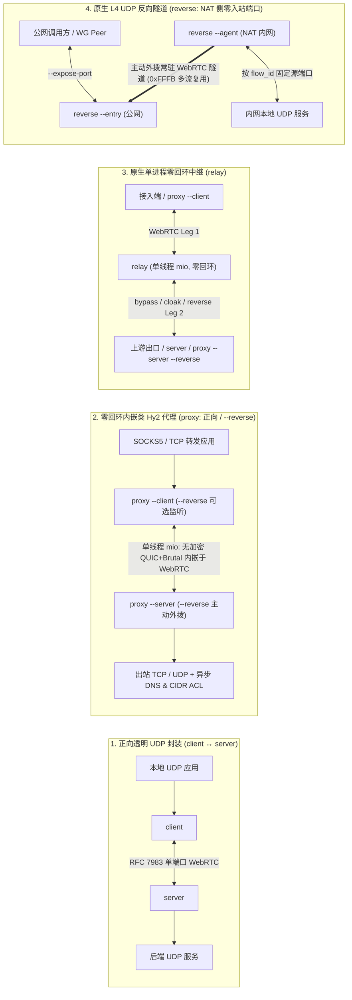
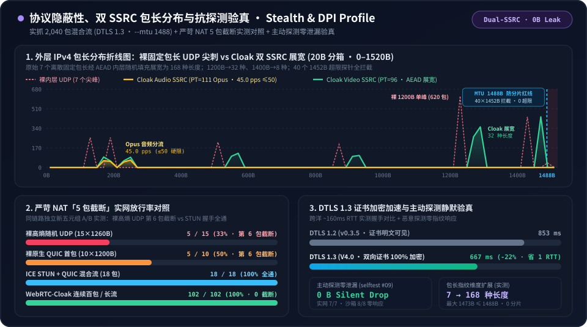
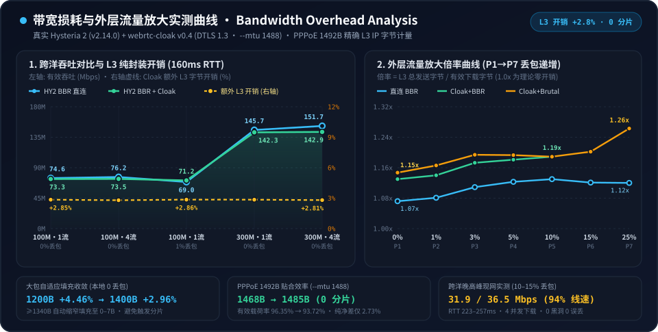
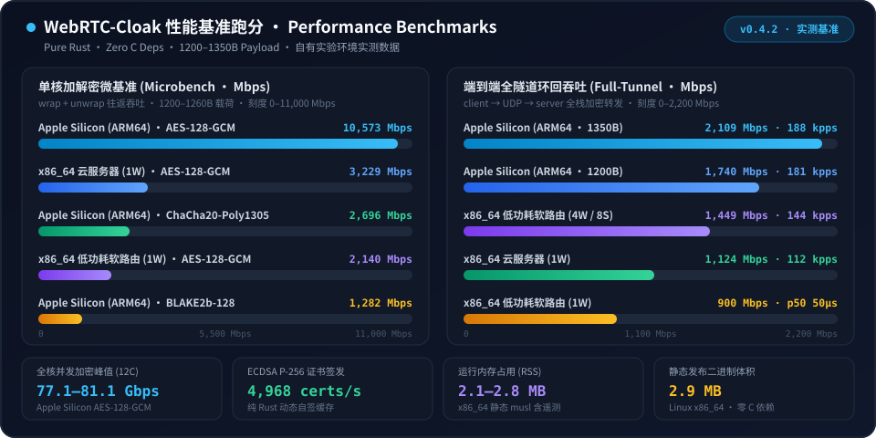

# WebRTC-Cloak (`webrtc-cloak-rs`)

[](./LICENSE)
[](#从源码构建与目录结构)
[](./SPEC.md)
[](https://mumu-dada.github.io/webrtc-cloak/)
[](https://github.com/MUMU-DADA/webrtc-cloak/releases)

> 快捷导航：[协议架构与六大模式](#协议架构与核心特性) · [全架构 SIMD 加速](#全架构指令集simd加速矩阵) · [实测数据与图表](#实测数据与效果对比) · [快速上手](#快速上手) · [自测诊断](#内置自测套件与基准诊断) · [源码构建](#从源码构建与目录结构) · [协议规范 (`SPEC.md`)](./SPEC.md)

一个**纯 Rust、零 C 依赖**的 WebRTC 单端口协议复用、透明 UDP 封装与可选零回环内嵌代理实验原型。基于标准 RFC 规范（RFC 5389 / 8445 / 7675 / 9147 / 6347 / 5764 / 7983 / 3711 / 7714 / 8285 / 3550 / 7587 / 9221），完整实现 `ICE STUN + Chrome/BoringSSL 对齐真双向加密证书 DTLS 1.3/1.2 + 动态 RFC 8285 双 SSRC SRTP/SRTCP` 传输层框架，覆盖**正向封装 (`client`/`server`)、可选零回环内嵌类 Hysteria 2 代理 (`proxy` 正向 / `--reverse` 反向)、单进程零回环原生中继 (`relay`)、零入站端口原生反向隧道 (`reverse`) 与带外优车道旁路直通 (`bypass`)** 全套模式，用于研究现代深度包检测（DPI）、UDP 状态化防火墙/CGNAT 黑洞自愈、ECMP 多路径优选、前向安全混合密钥派生以及高性能无锁 `mio` 事件循环架构。

> [!TIP]
> - **在线交互式原理演示**：👉 **[https://mumu-dada.github.io/webrtc-cloak/](https://mumu-dada.github.io/webrtc-cloak/)**（对抗与自愈推演、字节级报文解剖、双 SSRC / PPPoE MTU 1488 模拟，亦可离线打开 [`webrtc-cloak-demo.html`](./webrtc-cloak-demo.html)）
> - **协议规范文档（线格式 / 密钥派生 / 状态机 / 全模式与 SIMD）**：👉 **[`SPEC.md`](./SPEC.md)**（`V4.0 / v0.7.0`）
> - **全平台预编译下载（16 架构）**：👉 **[GitHub Releases](https://github.com/MUMU-DADA/webrtc-cloak/releases/latest)**（Linux 11 架构静态 musl、macOS ARM64/x86_64、Windows x86_64/ARM64/i686 与 `SHA256SUMS.txt`）

> [!IMPORTANT]
> **`v0.7.0` 升级与兼容说明**：`v0.7.0` 面向红蓝对抗深度加固引入了端点域分离 STUN HKDF（按端口与 `cloak`/`bypass` 隔离）、每会话 DTLS-PFS `mi_key_mig` 签名的 `Ready` 保活、动态多元素 `24B/28B` RFC 8285 RTP 扩展头、RFC 3550 `P=1` (`0xB0`) SRTP 填充以及默认 `--dtls-min-version 1.3`，**线格式不向前兼容 `v0.6.x`**，部署时需两端同步升级。若服务端位于 DNAT / Docker / `nftables` 端口映射之后（客户端目的端口与服务端监听端口不一致），两端或映射侧显式传入相同的 `--stun-scope <TAG>` 即可匹配。

---

## 免责声明

> [!CAUTION]
> **本项目仅用于网络协议学习、学术研究、RFC 规范实现验证及授权环境下的网络传输实验。**
>
> 1. 本仓库中的源码、文档、演示页面及预编译产物均以学习与研究为唯一目的提供，**严禁用于任何违反您所在国家或地区法律法规、网络服务条款或未经授权的网络渗透、规避监管等行为**。
> 2. 使用者须自行评估并承担使用本项目所产生的一切法律与合规责任。项目作者与贡献者不对任何因使用或滥用本软件造成的直接、间接、附带或衍生损失承担任何责任。
> 3. 若您不同意上述条款，请立即停止下载、编译、分发或使用本项目。

---

## 协议架构与核心特性

### 运行模式全景

`webrtc-cloak` 单一静态二进制内置五类传输/代理模式与内置诊断工具，按实际链路拓扑自由组合：

| 模式 | 子命令 | 适用场景与核心特性 |
| :--- | :--- | :--- |
| **正向加密隧道** | `client` ↔ `server` | 标准点对点透明 UDP 封装（STUN + DTLS 1.3 + 双 SSRC SRTP/SRTCP），支持 MBB `0xFFFC` 0 丢包轮换、1-RTT `0xFFFD` 黑洞迁移与 `--lane-hunt` 优车道 |
| **零回环内嵌类 Hy2 代理** | `proxy --client` ↔ `proxy --server` *(支持 `--reverse`)* | 默认 Cargo feature `embedded-proxy` 开启（可用 `--no-default-features` 裁剪）。与外层共享单线程 `mio::Poll`，内层 Sans-IO `quinn-proto`（No-op 加密、零 `rustls`、零二次 AEAD）+ Brutal 恒速丢包补偿 + RFC 9221 UDP 分片重组 + SOCKS5 / `--tcp-forward` + 异步 DNS & CIDR ACL + 视频帧尾包整形；支持 `--reverse` 实现 NAT 后零入站端口代理出口 |
| **原生零回环中继** | `relay` (`--upstream-mode bypass\|cloak\|reverse`) | **单进程单线程 `mio::Poll`** 融合入站 `ServerWorker` 与出站 `Bypass`/`Client`/`Reverse`，彻底消除本地回环 socket 与双进程切换；支持 `bypass`（非 DPI 裸 UDP + 带外 STUN 优选）、`cloak`（双段加密双 PSK）与 `reverse`（三跳零入站反向出口）三种形态 |
| **原生反向隧道** | `reverse --entry` ↔ `reverse --agent` | 类反向 WireGuard：**内网/NAT 侧零公网入站端口**，Agent 主动外拨 Entry 建立 24×7 常驻加密隧道；单隧道内借密文 `0xFFFB` 帧按 `flow_id: u32` 复用任意多条 L4 UDP 业务流，Agent 侧按流固定本地源端口，继承 MBB / 1-RTT / `--lane-hunt` |
| **旁路优车道直通** | `bypass` / `bypass --responder` | **仅限非 DPI 路由优选**：共享五元组带外极简 `68B` 认证 STUN 抽卡/劣化切路/黑洞逃生 + 数据面 0 封装原始 UDP 透传（兼容内核 `UDP_SEGMENT` / GSO、零二次加密） |
| **自测与基准工具** | `selftest` / `cpu` / `bench` / `sink` / `loadgen` | 线上零干扰 12 项实网体检、本地离线故障注入沙箱、全密码后端/SIMD 诊断与吞吐压测 |

### 典型拓扑示意



### RFC 7983 单端口四协议复用

两端在同一 UDP 五元组上严格按首字节分流，所有未通过鉴权或首字节异常的流量一律 **0 字节静默丢弃（Silent Drop）**：

| 首字节范围 | 协议层 | 核心能力（`v0.7.0`） |
| :--- | :--- | :--- |
| `0..=3` | **ICE STUN** (RFC 5389 / 8445 / 7675) | 端点域分离 HKDF（隔离端口与 `cloak`/`bypass`）、HMAC-SHA1 鉴权前零堆分配、`±10s` 新鲜度窗口、`SeenTxidCache`（`2.5s/2x` 仅限 DTLS 前）、`Ready` 态保活改用每会话 DTLS-PFS `mi_key_mig` 鉴权、RFC 8445 常规提名与 `HuntUfragTable` 墓碑隔离 |
| `20..=63` | **DTLS 1.3** (RFC 9147，默认锁定 `1.3`) | 定制补丁版纯 Rust Sans-IO **`dimpl 0.9.0` (`patches/dimpl`)**，对齐 Chrome/BoringSSL `ClientHello`（GREASE 书立扩展 + 内层扩展洗牌 + 套件/SRTP 序）、0% `HelloRetryRequest`、0% `0x0015` 零填充、RFC 9147 §4.2 密文内层随机填充、双向 ECDSA P-256 证书 100% 加密 |
| `128..=191` (`PT 64..95` 除外) | **双 SSRC SRTP** (RFC 3711 / 7714 / 8285) | 动态 `24B/28B` RFC 8285 多元素头（`abs-send-time`/`ssrc-audio-level` + `TWCC` + `MID`）与 `0x90`/`0xB0` (`P=1`) 混合填充；`PT=111` Opus（`≤50 pps`）+ `PT=96` 30/60 FPS 量化时钟 Video 双流分流，密文内承载业务及 `0xFFFE`–`0xFFFA` 控制/复用帧 |
| `128..=191` (`PT 64..95`) | **Compound SRTCP** (RFC 3550 / 7714) | 明文 `SR/RR` 头 + 加密复合 `SDES / FB / BYE`，严格零媒体语义、长静默双端对称低频 RR 与异步 `BYE → close_notify` 拆除 |

### 核心工程亮点

- **Chrome/BoringSSL 线格式对齐与深度防探测（`v0.7.0`）**：
  - **默认锁定 DTLS 1.3（`--dtls-min-version 1.3`）**：100% 免疫在途 1 字节降级篡改（0 明文 `CN=WebRTC` 证书泄露）；显式开启 `auto` 时亦内置 RFC 8446 §4.1.3 `DOWNGRD\x01` 降级哨兵。
  - **定制 `patches/dimpl` 零特征加固**：已鉴权 STUN 后跳过冗余 `HelloRetryRequest`（1-RTT 直出 `ServerHello`）、彻底移除 `0x0015 EXT_PADDING` 全零块、统一 `V13Only`/`auto` 下的 Chrome 套件序与 `use_srtp` 序、实现 BoringSSL 首位空 GREASE + 末位 1B `0x00` GREASE 书立与中间扩展 Fisher-Yates 洗牌，并对 DTLS 1.3 `Handshake` / `Ack` / `Alert` 启用 RFC 9147 §4.2 密文内层随机填充（彻底抹除 `709B`/`506B`/`72B`/`24B` 固定长度指纹）。
  - **抗拼接尾包损坏与伪造注入**：支持拼接 Flight-4 握手尾包局部已处理状态续传、`record_seq == 0` 精确校验与客户端 `ServerHello` 污染快速熔断（`< 9ms` 复位），实测加密尾包损坏 10/10 在 `274–409 ms` 内无感恢复。
- **域隔离 STUN 防重放与每会话 PFS 保活（`v0.7.0`）**：
  - `derive_stun_scope_key_for` 通过 HKDF-SHA256 按 `(cloak|bypass, port_or_scope)` 隔离密钥，跨端口/跨模式重放 0% 通过；时间戳偏差收紧至 `±10s`，`SeenTxidCache` 重传窗收紧至 `2.5s / 2x` 且进入 DTLS 即熔断（`Ready` 态 0 缓存重放）。
  - `Ready` 态 RFC 7675 保活与应答全部改用每会话 DTLS-PFS 派生的 `mi_key_mig` 鉴权，根治服务端 `SIGKILL` 重启后的假 64B 应答僵死与关断 `> 90s` 后的重放响应；`--lane-hunt` 遵循 RFC 8445 常规提名（共享 Chrome `4:4` Base64 `ufrag`/`tie_breaker` 与递减 `PRIORITY`，未提名探测不携带 `USE-CANDIDATE`，服务端 `HuntUfragTable` 强制 `ICE-CONTROLLING` + `4s` 同 IP 窗口 / `20s` 未提名墓碑 / `90s` 提名与关闭墓碑）。
- **动态多元素 SRTP 报头、真实视频时钟与对称静默（`v0.7.0`）**：
  - Video (`PT=96`) 动态组装 `abs-send-time + TWCC`（`24B`）并在起流/talkspurt 携带 `MID`（`28B`），Audio (`PT=111`) 携带 `ssrc-audio-level + TWCC`（含可选 `MID`，`24B`；接近 MTU 极限自动回落 `20B` TWCC-only 保护 `1422B` 零分片）；`pad_len >= 4` 的填充包约 `12.5%` 置 RFC 3550 `P=1`（`0xB0`）。
  - 90 kHz 视频时钟量化为真实 30/60 FPS 节奏（`min_dt >= 1320` ticks、单帧 `<= 60` 包、消除 3 包机械微帧），溢出至视频流的微小 ACK 包平滑展宽；PreWarm 预热会话免疫空闲超时从而实现 **0 `0xFFFE` 探针**；超过 60s 静默双端维持 `25–45s` 对称极低频 SRTCP RR；关闭流程在 `SRTCP BYE` 与 `DTLS close_notify` 间注入异步随机间隔（运行期 `18–95ms` / `SIGTERM` `22–65ms`）。
- **可选零回环内嵌类 Hysteria 2 代理（`proxy`, `v0.7.0`）**：
  - 进程内单线程 `mio::Poll` 融合 Sans-IO `quinn-proto`（自定义 No-op 加密后端 `tag_len == 0`，消除 `rustls`、二次 AEAD 与本地 `lo` 回环，全链路机密性由外层 DTLS 1.3 PFS + SRTP 独占保障）+ Hysteria 2 风格 Brutal 丢包补偿恒速拥塞控制 + RFC 9221 不可靠 QUIC Datagram（含自动分片重组）+ SOCKS5（`TCP CONNECT` + `UDP ASSOCIATE`）+ 可重复 `--tcp-forward` + 异步双线程 DNS 池与解析后 CIDR ACL。
  - **常驻免断线 + 双向大流视频帧尾包整形 + 反向孤儿回收**：代理外层隧道免疫 120s 数据静默拆除（132s 静默 0 SRTP 信标、0 DTLS 断流）；连续大流按 `5..=10 * mss + 500..=979B` 帧尾整形（`[450, 1150]B` 区间稳定 `~10.4–10.7%`，回环直通仍达 `1,586–2,037 Mbps`）且对交互微包零延迟惩罚（`0.1–0.4 ms`）与多流公平无饥饿；`proxy --reverse` 在对端 `SIGKILL` 重连产生 `NewConnection` 时自动回收旧 QUIC 与后端 TCP 句柄（0 泄漏）。
- **Fail-Closed 混合前向安全、V4.0 无感承载与 ECMP 优车道**：
  - `STUN 会话种子 + DTLS 出口密钥` 联合派生主密钥，Video / Audio / SRTCP 三域正交 Nonce；支持定时/定量 MBB `0xFFFC` 0 丢包过户、1-RTT `0xFFFD` 黑洞迁移（含 `--keepalive 0` 下行死锁自愈）、全链路 IPv4/IPv6 双栈、`--lane-hunt` 多维自适应优车道、Linux 可选 `--udp-batch` 零拷贝 `recvmmsg/sendmmsg` 与解耦外层健康遥测（`--status-file` / `--status-http`）。
- **轻量极致性能**：默认 `--workers 1` 单线程无锁 `mio` 事件循环即可承载千级并发会话（macOS ARM64 含 `embedded-proxy` 约 `2.1 MiB`，`--no-default-features` 纯 UDP 裁剪版更小；纯隧道常驻 **1 线程**、开启 HTTP 遥测 **2 线程**，macOS 实测 RSS `2.7–3.4 MiB`），Linux 多核按需支持 `--workers <N|auto>`。

> 📘 完整线格式字节布局、密钥派生公式、正交 Nonce 定义、全模式状态机与安全边界，请参阅 **[`SPEC.md`](./SPEC.md)**。

---

## 全架构指令集（SIMD）加速矩阵

`webrtc-cloak` 针对全部 16 个发布架构的密码学热路径做了逐 crate 审计与补丁加固（`v0.5.1`–`v0.7.0`）：
- **非 AVX x86/x86_64 硬件两级 `PCLMULQDQ`（[`patches/polyval`](./webrtc-cloak-rs/patches/polyval)）**：上游 `polyval` 仅在同时具备 `AVX + PCLMULQDQ` 时启用硬件 GHASH；补丁新增 Legacy SSE2 + `PCLMULQDQ` 二级运行时分发，使仅具 `AES-NI + PCLMULQDQ` 而无 `AVX` 的低功耗 x86 嵌入式/软路由 CPU 同样执行完整 4 块聚合硬件 GHASH。
- **全 64 位架构常时间 `radix-2^44` Poly1305（[`patches/poly1305`](./webrtc-cloak-rs/patches/poly1305)）**：上游 `poly1305` 除 `x86-avx2` 外全退化为 32 位 5-limb 实现（25 次乘法/块）；补丁在全部 64 位目标升级为常时间 `u64/u128` 3-limb `radix-2^44`（仅 9 次乘法/块），覆盖全部 `aarch64`（含无 AES 扩展而自动选 ChaCha20 的 ARMv8 路由器、树莓派与 Apple Silicon）、非 AVX2 `x86_64`、`riscv64`、`loongarch64`、`powerpc64le`。Apple Silicon 实测 `ChaCha20-Poly1305` 端到端 SRTP 加解密提升 **`+23.5%`（`3,261 → 4,027 Mbps`）**。
- **x86/x86_64 运行时 `AVX-512F+VL` ChaCha20（[`.cargo/config.toml`](./webrtc-cloak-rs/.cargo/config.toml)）**：启用 `chacha20_avx512` 运行时 CPUID 分发（16 块并行，无 AVX-512 自动回落 AVX2 → SSE2 → soft）。
- **真实后端探针与精准自动选型（`webrtc-cloak cpu`）**：补齐 `i686` 硬件检测，并由底层 crate 实际生效状态 `aes::hardware_accelerated() && polyval::hardware_accelerated()` 决定 `auto` 套件选择（杜绝仅看裸 CPUID 误选软件 AES-GCM 的问题，如 `windows-arm64` 自动安全回落至 NEON ChaCha20-Poly1305）；运行 `./webrtc-cloak cpu` 可直接核验当前机器每个密码学后端实际运行的指令集实现。

<details>
<summary>⚡ 展开查看 16 发布架构全密码学后端 SIMD 覆盖矩阵</summary>

| 目标平台 / CPU 类型 | `aes` (AES-128) | `polyval` (GHASH/GCM) | `chacha20` | `poly1305` | `sha1` / `sha2` | `--cipher auto` 选型 |
| :--- | :--- | :--- | :--- | :--- | :--- | :--- |
| **x86_64（现代 AVX2 / AVX-512）** | VAES-512 / VAES-256 / AES-NI | AVX+PCLMULQDQ | **AVX-512F+VL** / AVX2 / SSE2 | AVX2 | SHA-NI / AVX2 | `aes-128-gcm` |
| **x86_64（无 AVX 低功耗软路由/Atom）** | **AES-NI**（无 AVX 门控） | **SSE2+PCLMULQDQ**（补丁） | SSE2 | **radix44-u128**（补丁） | **SHA-NI**（无 AVX 门控） | `aes-128-gcm` |
| **i686（32 位 x86）** | **AES-NI** | **AVX / SSE2+PCLMULQDQ** | AVX-512 / AVX2 / SSE2 | AVX2 / radix26-u32 | SHA-NI / SSE4.1 | 有硬件走 AES-GCM，否则 ChaCha20 |
| **aarch64 Linux / macOS（含加密扩展）** | ARMv8 AES | ARMv8 PMULL (4-blk) | ARMv8 NEON | **radix44-u128**（补丁） | ARMv8 SHA2/SHA3 | `aes-128-gcm` |
| **aarch64 Linux（无 AES 扩展路由/板卡）** | soft | soft | ARMv8 NEON | **radix44-u128**（补丁） | soft | `chacha20-poly1305` |
| **aarch64 Windows** *(上游 `cpufeatures` 限制)* | soft | soft | ARMv8 NEON | **radix44-u128**（补丁） | soft | **安全回落 `chacha20-poly1305`** |
| **riscv64 / loongarch64 / powerpc64le** | soft | soft | soft | **radix44-u128**（补丁） | loongarch64 asm / soft | `chacha20-poly1305` |
| **armv7hf / armv7 / armhf / arm / armv5te** *(上游限制)* | soft | soft | soft | radix26-u32 | soft | `chacha20-poly1305` |

</details>

---

## 实测数据与效果对比

> 以下 5 组图表按 **「隐蔽抗探测 → 无感换口 → 弱网/黑洞自愈 → 带宽损耗 → 硬件算力」** 递进呈现，数据均来自实测采样。

### 1. 协议隐蔽性、双 SSRC 包长分布与抗探测验真



### 2. V4.0「换路不换门牌」MBB 无感五元组轮换实测


### 3. 恶劣垃圾网络对抗与黑洞自愈曲线


### 4. 带宽损耗与外层流量放大曲线



- **封装开销极低且恒定**：在 PPPoE `1492B` 环境下，`--mtu 1488` 自动引导内层 QUIC 收敛至零分片；跨 `100M / 300M` 单流与 4 并发场景，纯 L3 额外字节开销稳定在约 `+2.8% ~ +3.4%`，端到端有效吞吐损失约 `1.7% ~ 5.8%`。
- **自适应大包填充**：内层 `>= 1340B` 大包自动收窄随机填充（`0–7B`），常规包按 `0–63B` 展宽并配合 RFC 3550 `P=1` (`0xB0`) 打破窄箱分布。

### 5. 多平台加解密算力、原生中继、反向隧道与内嵌代理压测



#### 点对点基础算力与环回吞吐

| 测试平台 | 单核加解密微基准 (`AES-128-GCM` / `ChaCha20`) | 端到端全隧道环回吞吐 | 真双向 DTLS 1.3 握手 | 运行内存 (RSS) |
| :--- | :---: | :---: | :---: | :---: |
| **Apple Silicon (ARM64, 12C)** | `18,101–18,720 Mbps` / **`4,027 Mbps`** | `1,581–2,240 Mbps` (`165–222 kpps`) | `1.5–11.8 ms` | `2.7–3.4 MiB` (`1–2` 线程) |
| **x86_64 云服务器（单核 `1W`）** | `3,228.6 Mbps` (`320.3 kpps`) | `1,124.2 Mbps` (`111.5 kpps`) | `3.01 ms` | `2.1–2.8 MB` |
| **x86_64 低功耗软路由（单核 `1W`）** | `2,139.8 Mbps` (`212.3 kpps`) | `900.0 Mbps` (`0.00%` 丢包，p50 `50 µs`) | `6.85–9.02 ms` | `2.1–2.8 MB` |
| **x86_64 低功耗软路由（多核 `4W / 8S`）** | — | `1,448.7 Mbps` (`0.00%` 丢包，`143.7 kpps`) | `6.85–9.12 ms` | `2.5–2.8 MB` |

#### 原生单进程中继 (`relay`) vs 传统双进程回环 A/B 对比（Apple Silicon Release，1260B）

| 对比场景 | 吞吐变化 (`goodput`) | 中继侧总 CPU | 上下文切换 (`csw`) | 峰值内存 (`RSS`) |
| :--- | :---: | :---: | :---: | :---: |
| **`relay --upstream-mode bypass`（400 Mbps 稳态）** | `400.0 Mbps` (`0.00%` 丢包) | **`-29.1%`** | **`-68.4%`** | **`-42.1%`** |
| **`relay --upstream-mode bypass`（无节流峰值）** | **`2,251 Mbps (+16.8%)`** | **`-52.4%`** | — | — |
| **`relay --upstream-mode cloak`（400 Mbps 稳态）** | `400.0 Mbps` (`0.00%` 丢包) | **`-39.3%`** | **`-78.7%`** | **`-43.8%`** |
| **`relay --upstream-mode cloak`（无节流峰值）** | **`1,885 Mbps (+20.3%)`** | **`-58.7%`** | — | — |

#### 原生反向隧道 (`reverse`) 实测表现（Apple Silicon Release，1260B）

| 场景 | 首包延迟 (`hs`) | 丢包率 | 有效吞吐 (`goodput`) | 双端总 CPU | 双端合计 RSS |
| :--- | :---: | :---: | :---: | :---: | :---: |
| 正向基线 400 Mbps 稳态（100k） | `3.87 ms` | `0.00%` | `400.0 Mbps` | `1435.9 ms` | `6.72 MiB` |
| **反向隧道 400 Mbps 稳态（1 流）** | **`0.47 ms`** (0-RTT) | **`0.00%`** | **`400.0 Mbps`** | **`1437.9 ms`** | `6.77 MiB` |
| **反向隧道 400 Mbps（4 并发流复用 1 隧道）** | — | **`0.00%`** | **`400.4 Mbps`** | **`1363.3 ms`** | `6.77 MiB` |
| **反向隧道无节流峰值（AES-128-GCM）** | **`0.54 ms`** | — | **`1,833.9 Mbps`** (`181.9 kpps`) | `633.7 ms` | `6.77 MiB` |
| **反向隧道无节流峰值（ChaCha20-Poly1305）** | **`0.33 ms`** | — | **`1,442.9 Mbps`** (`143.1 kpps`) | `660.6 ms` | `6.75 MiB` |

#### 零回环内嵌类 Hy2 代理 (`proxy`, `v0.7.0`) 实测表现（Apple Silicon Release）

| 测试场景 | 实测吞吐 / 延迟 | 伪装与稳定性指标 |
| :--- | :---: | :--- |
| **正向 `proxy` 大流直通（DL / UL）** | **`1,586 – 2,037 Mbps`** | `[450, 1150]B` 视频帧尾包 `10.35% – 10.71%`，无大流断流/饥饿 |
| **反向 `proxy --reverse` 大流直通（DL / UL）** | **`1,653 – 1,778 Mbps`** | 与正向一致的双向视频帧尾包整形，对端 `SIGKILL` 后 `0` 孤儿 TCP/QUIC 残留 |
| **交互微小载荷延迟（TCP 回显 p95）** | **`0.1 – 0.4 ms`** | 不凑帧、零缓冲延迟惩罚；多流并发大流+交互流零饥饿 |
| **132s 静默常驻保活（默认 `--idle-timeout 120`）** | `100%` 存活、首包秒恢复 | **`0` 条 `0xFFFE` SRTP 信标**、`0` 次非预期 DTLS 断流，双端对称低频 SRTCP RR |

> 微基准测试 `1200–1260B` 载荷单次 `wrap + unwrap` 往返吞吐；依赖统一至 RustCrypto `0.11`/`0.14` 代际并启用 `fat LTO` + 混合 `-O3/-Os` 优化以及 64 位 `radix-2^44` Poly1305 补丁后，Apple Silicon 同机实测 `AES-128-GCM` `18,101–18,720 Mbps`（12 核 `127.4 Gbps`）、`ChaCha20-Poly1305` `4,027.4 Mbps`、`BLAKE2b-128` `1,293.9 Mbps`，纯 Rust ECDSA P-256 临时证书签发速率 `13,005 certs/s`（上方历史基准 SVG 图表基于早期采样）。

### 综合对抗与工程边界总览

| 对抗 / 故障场景 | 裸 UDP / 早期版本 | **WebRTC-Cloak V4.0 (`v0.7.0`)** |
| :--- | :--- | :--- |
| **DTLS 1.3 主动探测、降级与指纹识别** | 明文证书泄露 / 固定 `0x0015` 填充 / 固定 Flight-4/5 长度 | 默认锁定 DTLS 1.3（0 降级、0 明文证书）、Chrome/BoringSSL GREASE 书立 + 套件/SRTP 序、0% HRR、RFC 9147 §4.2 密文内层随机填充、主动探针 `0 B` 静默丢弃 |
| **STUN 重放、跨端口探测与 `SIGKILL` 僵死** | 静态 PSK 保活易被跨口/关断后重放或重启后假 64B 死锁 | 端点域分离 HKDF（`0/8` 跨口/跨模式重放）、`±10s` 新鲜度、`2.5s/2x` 仅 DTLS 前缓存、`Ready` 态每会话 `mi_key_mig` 保活 + `HuntUfragTable` 墓碑隔离 |
| **严苛 NAT 5 包截断 & 媒体流特征** | 裸 UDP/QUIC 第 6 包截断；固定 `20B` RTP 头与机械微帧 | 动态 `24B/28B` RFC 8285 扩展头 + `P=1` (`0xB0`) 混合填充 + 30/60 FPS 量化视频时钟 + 异步 `BYE → close_notify` + 内嵌代理双向视频帧尾包整形 |
| **定时 / 定量五元组轮换 (MBB)** | 固定五元组易关联；硬重连断流 | 全新 DTLS 1.3 换口 + `0xFFFC` 密文过户：**`0.00%` 丢包、`0 ms` 卡顿、后端 `0` 换口** |
| **弱网丢包 & P8 单向上行黑洞** | 裸 HY2 在单向上行黑洞下永久死锁在 `0 Mbps` | 约 `5s` 自动 1-RTT 换口满血恢复，内层零断流、后端源端口零变更；加密握手尾包损坏 `10/10` 在 `274–409ms` 恢复 |
| **NAT 后无公网 IP / 多跳中继 / 零回环代理** | 需双进程回环或外挂独立代理/反代软件 | 单二进制原生覆盖零回环 `relay`（支持 `bypass`/`cloak`/`reverse`）、零入站 `reverse` 与零回环内嵌 `proxy`（正向 / `--reverse`） |

> [!NOTE]
> **工程定位与适用边界**：
> - `client`/`server`/`relay`/`reverse` 为透明 UDP 封装外壳；`proxy` 为可选内嵌 TCP/UDP（SOCKS5 + TCP 转发）代理（非内核 TUN VPN）。
> - `bypass` 模式为**非 DPI 路由优选直通**（裸 UDP 数据面），不提供抗 DPI 封装，且不可直接承载无加密内层的 `proxy`。
> - 任何基于 UDP 的传输都无法绕过彻底封禁 100% UDP 出口的网络策略，且单租户 `(src_ip, dst_ip)` 宏观 NetFlow 流量相关性仍受限于物理带宽与部署拓扑。

---

## 快速上手

> 实验部署示例：从 **[GitHub Releases](https://github.com/MUMU-DADA/webrtc-cloak/releases/latest)** 下载对应平台/架构的预编译压缩包，解压得到 `webrtc-cloak`（或 `webrtc-cloak.exe`）。

### 1. 生成共享密钥文件

```bash
openssl rand -base64 32 > /tmp/webrtc-cloak.psk
chmod 600 /tmp/webrtc-cloak.psk
```

### 2. 按需选择部署模式

#### 模式 A：正向透明 UDP 加密封装（`server` + `client`）

```bash
# 服务端：默认单线程 (--workers 1)、--cipher auto、--dtls-min-version 1.3、--mtu 1488
./webrtc-cloak server \
  --listen-host 0.0.0.0 --listen-port 19643 \
  --backend-host 127.0.0.1 --backend-port 19760 \
  --psk-file /tmp/webrtc-cloak.psk

# 客户端（也支持环境变量 WEBRTC_CLOAK_PSK="..." 传入密钥；可选 --lane-hunt）
./webrtc-cloak client \
  --listen-host 127.0.0.1 --listen-port 19543 \
  --server-host 203.0.113.10 --server-port 19643 \
  --psk-file /tmp/webrtc-cloak.psk --lane-hunt
```

> 若服务端经 DNAT / Docker 端口映射（如公网 `443` → 内网 `19643`），在服务端（或双端）追加 `--stun-scope 443` 即可保持 STUN HKDF 域一致。

#### 模式 B：零回环内嵌类 Hysteria 2 代理（`proxy`，正向与 `--reverse` 反向）

```bash
# B1. 正向内嵌代理：公网出口服务端（支持 --acl-allow / --acl-deny / --allow-private）
./webrtc-cloak proxy --server \
  --listen-host 0.0.0.0 --listen-port 19643 \
  --max-up 500Mbps --max-down 500Mbps \
  --psk-file /tmp/webrtc-cloak.psk

# 正向内嵌代理：本地客户端（暴露 SOCKS5 127.0.0.1:19548 + 可选 --tcp-forward）
./webrtc-cloak proxy --client \
  --server-host 203.0.113.10 --server-port 19643 \
  --socks-listen 127.0.0.1:19548 \
  --tcp-forward 127.0.0.1:19443=198.51.100.10:443 \
  --up 100Mbps --down 300Mbps \
  --psk-file /tmp/webrtc-cloak.psk --lane-hunt

# B2. 反向内嵌代理（出口位于 NAT 内网、零公网入站端口）：
# 入口/公网侧运行 proxy --client --reverse（监听外层隧道并暴露本地 SOCKS5/TCP 转发）
./webrtc-cloak proxy --client --reverse \
  --listen-host 0.0.0.0 --listen-port 19643 \
  --socks-listen 127.0.0.1:19548 \
  --up 100Mbps --down 300Mbps \
  --psk-file /tmp/webrtc-cloak.psk

# 出口/NAT 内网侧运行 proxy --server --reverse（主动外拨入口建立 24×7 常驻隧道）
./webrtc-cloak proxy --server --reverse \
  --server-host 203.0.113.10 --server-port 19643 \
  --max-up 500Mbps --max-down 500Mbps \
  --psk-file /tmp/webrtc-cloak.psk --lane-hunt
```

#### 模式 C：原生单进程零回环中继（`relay`）

```bash
# C1. 入站 WebRTC 终止 + 出站 bypass 原始 UDP 优车道直通（仅非 DPI 链路，省二次加解密）
./webrtc-cloak relay \
  --listen-host 0.0.0.0 --listen-port 19643 \
  --upstream-mode bypass \
  --upstream-host 198.51.100.20 --upstream-port 19643 \
  --psk-file /tmp/leg1.psk --upstream-psk-file /tmp/leg2.psk \
  --udp-batch 32

# C2. 入站 WebRTC + 出站 WebRTC 双段独立加密中继（零本地回环）
./webrtc-cloak relay \
  --listen-host 0.0.0.0 --listen-port 19643 \
  --upstream-mode cloak \
  --upstream-host 198.51.100.20 --upstream-port 19643 \
  --psk-file /tmp/leg1.psk --upstream-psk-file /tmp/leg2.psk \
  --lane-hunt --udp-batch 32

# C3. 三跳反向中继：接收接入端 WebRTC，同时监听上游 NAT 出口主动拨入的反向隧道
./webrtc-cloak relay \
  --listen-host 0.0.0.0 --listen-port 19643 \
  --upstream-mode reverse \
  --reverse-listen-host 0.0.0.0 --reverse-listen-port 19644 \
  --psk-file /tmp/leg1.psk --upstream-psk-file /tmp/leg2.psk
```

#### 模式 D：原生 L4 UDP 反向隧道（`reverse --entry` + `reverse --agent`，NAT 侧零入站端口）

```bash
# 公网入口端（Entry）：监听 WebRTC 隧道端口 19643，并将内网 UDP 服务暴露在 51820
./webrtc-cloak reverse --entry \
  --listen-host 0.0.0.0 --listen-port 19643 \
  --expose-host 0.0.0.0 --expose-port 51820 \
  --psk-file /tmp/webrtc-cloak.psk

# 内网/NAT 出口端（Agent）：零公网入站端口，主动外拨 Entry 并转发到本地 127.0.0.1:51820
./webrtc-cloak reverse --agent \
  --server-host 203.0.113.10 --server-port 19643 \
  --backend-host 127.0.0.1 --backend-port 51820 \
  --psk-file /tmp/webrtc-cloak.psk --lane-hunt
```

#### 模式 E：一级旁路优车道直通（`bypass` + `bypass --responder`，仅限非 DPI 路由优选）

```bash
# 远端超轻量 STUN 应答器（与业务 UDP 服务同机或同五元组）
./webrtc-cloak bypass --responder \
  --listen-host 0.0.0.0 --listen-port 19643 \
  --psk-file /tmp/webrtc-cloak.psk

# 入口侧旁路转发器（带外极简 68B 认证 STUN ECMP 抽卡/劣化切路/黑洞自愈 + 数据面原始 UDP 直通）
./webrtc-cloak bypass \
  --listen-host 127.0.0.1 --listen-port 19543 \
  --server-host 203.0.113.10 --server-port 19643 \
  --psk-file /tmp/webrtc-cloak.psk
```

### 3. 主要命令行参数

| 参数 | 默认值 | 说明 |
| :--- | :---: | :--- |
| `--psk-file <PATH>` / `WEBRTC_CLOAK_PSK` / `--psk <KEY>` | 必填其一 | 预置共享密钥（推荐文件或环境变量，避免进程列表泄露） |
| `--stun-scope <TAG>` / `--upstream-stun-scope <TAG>` | 自动按监听/目的端口 | 可选显式 STUN HKDF 作用域标签（经 DNAT / 端口转发部署时用于双端显式对齐） |
| `--cipher <auto\|aes-gcm\|chacha20\|blake2b>` | `auto` | 加密套件；`auto` 依据两端真实硬件加速能力经 DTLS 握手自动协商 |
| `--dtls-min-version <1.3\|1.2\|auto>` | **`1.3`** | DTLS 最低版本；`v0.7.0` 默认锁定 `1.3` 防降级与零明文证书泄露，仅在特殊互操作场景显式指定 `auto`/`1.2` |
| `--client` / `--server` / `--reverse` *(仅 `proxy`)* | 必填角色 | 内嵌类 Hy2 代理角色；加 `--reverse` 切换外层拨号方向（`--client --reverse` 监听、`--server --reverse` 外拨） |
| `--socks-listen <IP:PORT>` / `--no-socks` *(仅 `proxy --client`)* | `127.0.0.1:19548` | 本地 SOCKS5 监听地址（支持 TCP + UDP Associate）；纯端口转发场景可用 `--no-socks` 关闭 |
| `--tcp-forward <LOCAL=TARGET>` *(仅 `proxy --client`, 可重复)* | 无 | 本地 L4 TCP 端口直通转发规则（如 `127.0.0.1:19443=example.com:443`） |
| `--up` / `--down` *(仅 `proxy --client`)* | `100Mbps` / `300Mbps` | 客户端声明的上下行 Brutal 拥塞控制目标带宽（支持 `Kbps`/`Mbps`/`Gbps`） |
| `--max-up` / `--max-down` *(仅 `proxy --server`)* | `500Mbps` / `500Mbps` | 服务端允许的上下行 Brutal 带宽硬上限 |
| `--proxy-mtu <BYTES>` *(仅 `proxy`)* | 自动推导 | 可选覆写内层 QUIC 最大 UDP 载荷 MTU |
| `--acl-allow` / `--acl-deny <CIDR[:PORT]>` *(仅 `proxy --server`, 可重复)* | 默认拒绝私网 | 解析后出站目标 CIDR/端口 ACL 规则；配合 `--allow-private`（允许私网/回环）与 `--outbound-ipv4-only` |
| `--upstream-mode <bypass\|cloak\|reverse>` *(仅 `relay`)* | `bypass` | 中继出站形态：`bypass`（裸 UDP 直通）、`cloak`（二段 WebRTC 加密）或 `reverse`（监听反向出口拨入） |
| `--upstream-host` / `--upstream-port` / `--reverse-listen-port` *(仅 `relay`)* | 按模式必填 | `bypass`/`cloak` 指定上游目标；`reverse` 指定 `--reverse-listen-port`（可选 `--reverse-listen-host`） |
| `--upstream-psk[-file]` / `WEBRTC_CLOAK_UPSTREAM_PSK` *(仅 `relay`)* | 同入站 PSK | 可选独立上游 PSK；另支持 `--upstream-cipher`、`--upstream-dtls-min-version`、`--upstream-stun-scope` |
| `--entry` / `--agent` *(仅 `reverse`)* | 二选一必填 | 反向 UDP 隧道角色：公网入口端 (`--entry` + `--expose-host`/`--expose-port`) 或 NAT 内网出口端 (`--agent` + `--server-host`/`--backend-port`) |
| `--lane-hunt` / `--no-lane-hunt` | `bypass` 默认开，其余默认关 | 非阻塞 ECMP 多维自适应优车道引擎（RFC 8445 常规提名 + 冷启动校准 + 数据面丢包/RTT/抖动综合评分与 Canary 确认 + 0ms MBB 逃逸） |
| `--lane-probes <2..=8>` / `--lane-rounds <1..=6>` | `4` / `3` | 单轮并发 STUN 候选探测口数量与最大多轮探测次数 |
| `--lane-target-rtt <MS>` / `--lane-cooldown <5..=3600>` | `0`（纯自适应）/ `60s` | 可选显式 RTT 上限（`0` 自动按冷启动最低延迟建基线）与劣化寻优冷却秒数 |
| `--rotate-interval <SECS>` / `--rotate-bytes <MB>` | `0` / 随轮换启 `1200` | 定时（对数正态 `[0.35x, 2.80x]`）与单流字节预算（`[0.50x, 1.85x]`）MBB 无感五元组轮换 |
| `--udp-batch <0\|2..64>` | `0`（关闭） | Linux 可选 `recvmmsg/sendmmsg` 批量 UDP 收发批大小（如 `32`）；非 Linux 自动回退单包 I/O |
| `--workers <1\|N\|auto>` | `1` | 工作线程数；默认 `1` 单线程，Linux 可选多核 `SO_REUSEPORT`（`reverse`/`proxy` 自动锁定为 `1`） |
| `--keepalive <SECS>` | `5` | RFC 7675 STUN Consent 保活间隔（`±20%` 抖动；`Ready` 态采用 `mi_key_mig` 签名，连续 3 次无应答触发 1-RTT 迁移） |
| `--idle-timeout <SECS>` | `120` | 空闲超时后优雅拆除会话（`reverse` 与 `proxy` 常驻隧道免疫数据静默超时） |
| `--max-sessions <N>` | `4096` | 单 worker 最大并发 UDP 会话数（`reverse` 中对应最大并发复用流数） |
| `--mtu <BYTES>` | `1488` | 外层 IPv4/IPv6 WAN MTU 上限（适配 `1492B` PPPoE 零分片；`0` 表示不限制） |
| `--status-file <PATH>` / `--status-http <IP:PORT>` | 关闭 | 外层健康快照原子 JSON 落盘路径与本地只读 HTTP / Prometheus 端点（`/status` `/health` `/healthz` `/metrics`） |
| `--status-interval <SECS>` | `5` | 遥测快照刷新周期（`1..=60s`；黑洞/迁移/轮换事件即时刷新） |

---

## 内置自测套件与基准诊断

`webrtc-cloak` 内置三种诊断工具，覆盖**线上零干扰体检**、**公网满载压测**与**本地离线故障注入**：

```bash
# 方式 A：直测已运行的线上隧道（独立临时会话 + 带内 0xFFFE 探针，零干扰线上业务，约 3–6 秒）
./webrtc-cloak selftest --server-host 203.0.113.10 --server-port 19643 --psk-file /tmp/webrtc-cloak.psk
./webrtc-cloak selftest --server-host 203.0.113.10 --server-port 19643 --psk-file /tmp/webrtc-cloak.psk --count 30 --no-probe --json

# 方式 B：双端临时独立端口极限带宽压测（服务端先起 sink + server，客户端连入后运行 loadgen）
./webrtc-cloak sink 127.0.0.1:19799
./webrtc-cloak loadgen 127.0.0.1:19599 50000 1200 100 100 4

# 方式 C：本地离线 12 项故障注入沙箱 + 真实密码后端 SIMD 诊断与三套件基准
./webrtc-cloak selftest --local
./webrtc-cloak cpu
./webrtc-cloak bench 50000 1260 all
```

<details>
<summary>📋 展开查看 12 项线上直测场景明细 (#01–#12)</summary>

| 编号 | 线上直测场景 | 实测内容与运维价值 |
| :---: | :--- | :--- |
| `#01` | **WAN ICE STUN & NAT Mapping** | 实测真实公网域隔离 STUN RTT 与外网 `IP:Port`（`XOR-MAPPED-ADDRESS`） |
| `#02` | **WAN DTLS Mutual-Cert HS** | 真实公网 DTLS 1.3 握手耗时、协议版本、双 SSRC 状态与加密套件 |
| `#03` | **WAN Consent RTT/Jitter/Loss** | 连续 `N` 次每会话 `mi_key_mig` 签名 RFC 7675 保活探测，统计 P50/P95 RTT、抖动与丢包率 |
| `#04` | **WAN STUN Retransmit Cache** | 验证线上服务端 `SeenTxidCache` 初始握手同 `txid` 幂等重传缓存 |
| `#05` | **WAN Server SRTCP Heartbeat** | 校验服务端穿透公网 NAT 下发的 AEAD `Compound SRTCP` 心跳 |
| `#06` | **WAN SRTP Data-Plane Echo** | 发送 `30 × 1200B` 加密带内 `0xFFFE` 探针，测数据面 RTT、丢包、乱序与封装开销（永不转发给后端） |
| `#07` | **WAN Path MTU Anti-Frag Probe** | 梯度探测 `1000..1422B` 公网实通极限与 `1452B` 本地防分片拦截 |
| `#08` | **WAN 5-Tuple Rotate & NAT** | 开启第二端口完成新握手，验证换口可用性并识别 NAT 端口映射行为 |
| `#09` | **WAN Active Probe Silent-Drop** | 并行发送 7 类恶意探针直击线上端口，验真 **0 字节静默丢弃** 且正常会话不受影响 |
| `#10` | **Graceful Teardown (BYE/Close)** | 发送异步加密 `SRTCP BYE + DTLS close_notify` 优雅拆除测试会话，零僵尸残留 |
| `#11` | **CPU Single-Core Crypto Bench** | 本机单核全三套密码（`AES-128-GCM` / `ChaCha20-Poly1305` / `BLAKE2b-128`）加解密吞吐 |
| `#12` | **CPU Multi-Core & P-256 Certs** | 本机全核并发加密算力天花板（Gbps）+ 临时 ECDSA P-256 证书签发速率（`certs/s`） |

</details>

---

## 从源码构建与目录结构

```bash
cd webrtc-cloak-rs
cargo test --all-targets                                          # 56 项协议不变式、内嵌代理、中继、反向隧道与安全回归测试
cargo test --no-default-features --all-targets                    # 46 项精简纯 UDP 封装模式回归测试
cargo build --release                                             # 编译默认全功能 Release 版本（含 embedded-proxy）
cargo build --release --no-default-features                       # 可选：裁剪 quinn-proto，编译极简纯 UDP 封装版本
rustup target add x86_64-unknown-linux-musl                       # 可选：交叉编译 Linux 静态 musl
cargo build --release --target x86_64-unknown-linux-musl
```

> 注：macOS 默认 `ulimit -n` 为 `256`，并发运行 56 项网络集成测试前建议先执行 `ulimit -n 4096`。

```text
.
├── .github/workflows/                     # CI 门禁 + 16 架构 Release 自动发布 + GitHub Pages 部署
├── docs/
│   ├── stealth-fingerprint-profile.svg    # 1. 双 SSRC 包长分布与抗探测特征图
│   ├── mbb-zero-loss-rotation.svg         # 2. V4.0 MBB 无感轮换时序折线图
│   ├── trash-network-resilience.svg       # 3. 恶劣弱网对抗与黑洞自愈折线图
│   ├── bandwidth-overhead.svg             # 4. 带宽损耗与外层流量放大折线图
│   └── benchmark-performance.svg          # 5. 多平台加解密算力与全隧道环回跑分图
├── README.md                              # 项目说明、全模式指南、SIMD 矩阵与实测对比
├── SPEC.md                                # V4.0 / v0.7.0 线格式、密码学、全模式与状态机协议规范
├── webrtc-cloak-demo.html                 # 交互式协议原理演示页（离线 / GitHub Pages）
├── LICENSE                                # MIT 开源许可证
└── webrtc-cloak-rs/                       # 纯 Rust 源码工程（零 C 外部库依赖 / 零 OpenSSL）
    ├── .cargo/config.toml                 # 跨架构静态 musl / AVX-512 ChaCha20 运行时开关
    ├── Cargo.toml                         # 默认启用 embedded-proxy，支持 --no-default-features 裁剪
    ├── patches/
    │   ├── dimpl/                         # Chrome/BoringSSL DTLS 1.3 GREASE、0% HRR、RFC 9147 内层填充与抗损坏补丁
    │   ├── polyval/                       # x86 两级 PCLMULQDQ (AVX + Legacy SSE2) 与真实后端探针补丁
    │   └── poly1305/                      # 全 64 位架构常时间 radix-2^44 (u64/u128) Poly1305 补丁
    └── src/
        ├── main.rs                        # CLI 参数解析 (pico-args) 与全子命令分发
        ├── constants.rs                   # 跨模块共享的协议契约、帧魔数、缓冲与双端耦合时序常量
        ├── bench_tools.rs                 # cpu (真实 SIMD 后端) / bench / sink / loadgen 诊断工具
        ├── protocol/                      # 域隔离 STUN / dimpl DTLS 1.3+1.2 / X.509 / 动态 RFC 8285 双 SSRC SRTP / SRTCP
        ├── client/                        # 客户端 mio 循环、1-RTT 黑洞迁移、MBB 状态机、ECMP 优车道与测试
        ├── server/                        # 服务端 mio 循环、SeenTxidCache、HuntUfragTable 墓碑、跨 worker 注册表与 Silent Drop
        ├── proxy/                         # 可选零回环内嵌类 Hy2 代理（No-op quinn-proto、Brutal、SOCKS5、TCP 转发、ACL、反向模式）
        ├── relay/                         # 原生单进程零回环中继模式 (bypass / cloak / reverse 三出站) 与测试
        ├── reverse/                       # 原生 L4 UDP 反向隧道模式 (entry / agent, 0xFFFB/0xFFFA 多流复用) 与测试
        ├── bypass/                        # 一级旁路直通模式（极简 68B 带外 STUN ECMP 抽卡 + 原始 UDP 零损耗透传）
        ├── udp_batch.rs                   # 可选 Linux recvmmsg/sendmmsg 批量收发引擎 (--udp-batch)
        ├── selftest/                      # 线上直测 + 本地离线 12 项自测、劣化代理与报告渲染
        └── telemetry/                     # 外层链路健康只读遥测（原子 JSON / HTTP / Prometheus）
```

---

## 开源协议

本项目基于 **[MIT License](./LICENSE)** 开源发布。
